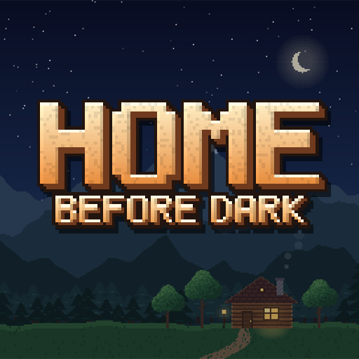
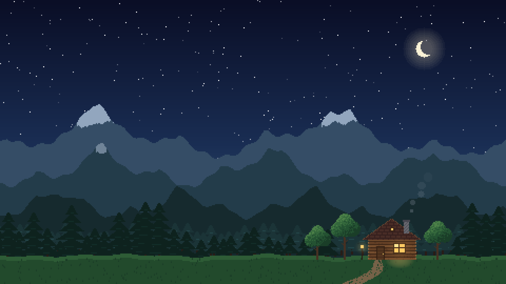
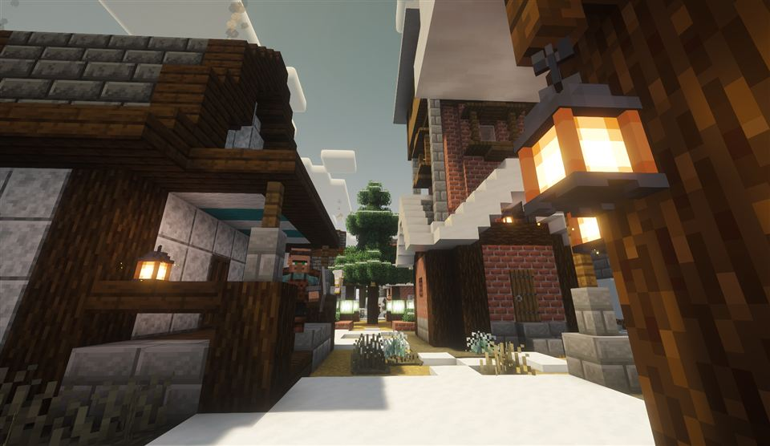
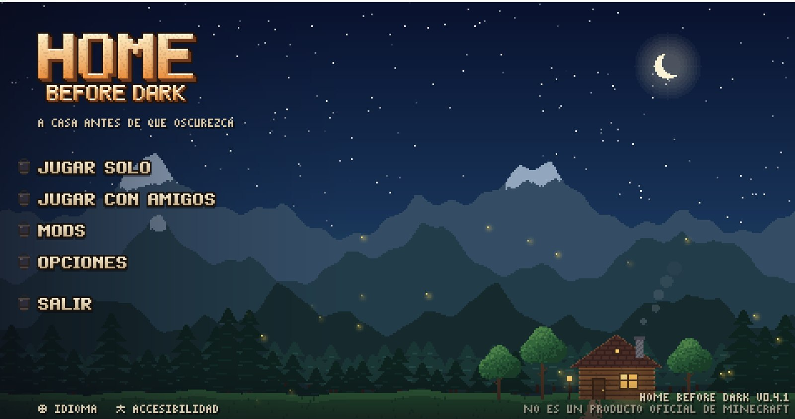

# Home Before Dark





**Modpack cooperativo de Minecraft** para un grupo de amigos: mundo medieval de aventura, magia y construcción, con
misiones propias, estaciones reales, nieve que se acumula y un menú hecho a mano. **Todo en español.**

`v0.4.1` · Minecraft **1.21.1** · NeoForge **21.1.265** · Java 21 · **268 mods**


---

## Qué es

Home Before Dark nace para jugar en grupo sin pelearse con la instalación: un `.mrpack` que se importa en ATLauncher,
trae los ajustes listos y deja a todos con el mismo pack. La idea es un valle medieval con algo que hacer en cada
dirección: mazmorras, dimensiones, magia, oficios y una casa que se va armando entre todos.



## Lo que trae

| | |
|---|---|
| **Mundo** | Terralith, Regions Unexplored, Tectonic, River Redux, Better Caves, YUNG's (mazmorras, minas, fortalezas, templos), When Dungeons Arise, Structory, Incendium, Nullscape |
| **RPG** | Clases y árbol de habilidades (Pufferfish's Skills), magia de Iron's Spellbooks, Archers, Paladines, Pícaros, Simply Swords, Epic Knights, jefes (Cataclysm, Mowzie's, Ice and Fire) |
| **Dimensiones** | Twilight Forest, The Aether (+ Deep Aether), Undergarden, Deeper and Darker, Eternal Starlight |
| **Misiones** | Libro de FTB Quests con **6 capítulos y 68 misiones** escritas en español, con fondo propio por capítulo |
| **Construcción y almacenamiento** | Create, Macaw's completo, Chipped, Rechiseled, Handcrafted, AE2, Storage Drawers, Tom's Simple Storage, Traveler's Backpack |
| **Vida y ambiente** | Serene Seasons, Enhanced Celestials 2, Fresh Animations + Fresh Compats, Vocal Villagers, AmbientSounds, Sound Physics, partículas de lluvia y hojas |
| **Invierno** | Winterly, Snow! Real Magic, Snow Under Trees, Wintery Atmosphere, Macaw's Holidays y decoración navideña (desactivable) |
| **Presentación** | Menú propio de FancyMenu con ciclo de estaciones (sin parallax), música y ambiente propios, pantallas de carga por estación y 62 consejos escritos para el pack |
| **Interfaz** | Tooltips con color por rareza y modelos 3D (Legendary Tooltips), baldes 3D con ajolote animado, JEI + EMI, Jade, mapa y minimapa (FTB Chunks), chat de voz (Simple Voice Chat) |
| **Gráficos** | Complementary Reimagined + Euphoria Patches configurados, Distant Horizons, Sodium/Iris, 7 texture packs (JICKLUS, Better Leaves, Fresh Animations, Fresh Compats…) |

### El menú



La pantalla de título de Minecraft se reemplaza por una propia: el mismo valle pasa por las cuatro estaciones cada 32 s
(sin parallax), con ambiente y música que cambian con la estación, logo dibujado a mano, botones tipo farol con fuente
pixel propia y la versión del pack abajo a la derecha. Las pantallas de carga también cambian según el mes real y
muestran 62 consejos escritos para el pack.

## Instalación

1. Descargá el `.mrpack` desde [**Releases**](../../releases) (o exportalo con `scripts/export.ps1`).
2. ATLauncher → **Instances** → **Import** → elegir el archivo.
3. Asignar **8 GB de RAM** a la instancia.
4. En ATLauncher → *Settings* → *Java/Minecraft* → **Java Parameters**, poner:

   ```
   -XX:+UseShenandoahGC -XX:+PerfDisableSharedMem
   ```

   Sin eso el launcher usa G1 y Distant Horizons avisa de tirones de FPS al entrar al mundo.
5. Jugar. Los shaders vienen activados (**F6** los apaga, **O** abre los ajustes).

> Para armar un servidor para el grupo: `scripts/make-server.ps1` crea la carpeta del servidor con NeoForge, los mods de
> servidor, configs y misiones. Ver [Servidor](#servidor).

## Controles

| Tecla | Acción | Tecla | Acción |
|---|---|---|---|
| **F6** | Shaders (Iris) | **M** | Mapa (FTB Chunks) |
| **O** | Elegir shader | **B** | Mochila |
| **K** | Árbol de habilidades | **G** | Accesorios (Curios) |
| **R** | Rodar (esquiva) | **X** | Rueda de hechizos |
| **Z** | Zoom | **V** | Lanzar hechizo |
| **J** | Órdenes a reclutas | **\`** | FTB Ultimine (talar/minar en área) |
| **F8** | Ajustes de chat de voz | **F10** | Silenciar micrófono |

Los conflictos de teclas ya vienen resueltos en `pack/config/defaultoptions/options.txt`.

## Rendimiento

Medido en un portátil (i5-13500H, RTX 4050 6 GB, 8 GB de RAM asignados) con este pack:

| Recolector de basura | Tiempo al menú |
|---|---|
| G1 (lo que pone ATLauncher por defecto) | 101,7 s — con tirones |
| ZGC generacional | 180 s — sin tirones, pero castiga la carga |
| **Shenandoah** (recomendado) | **114,7 s** — sin pausas largas |

La carga con 268 mods ronda los 100–120 s. Si el equipo va justo:

- **Distant Horizons** → *Distance* 96 → 64 chunks y *Quality* `BLOCK` → `HALF_CHUNK`.
- Ajustes del shader (**O**) → perfil *Alto* → *Medio*.

## Servidor

```powershell
powershell -ExecutionPolicy Bypass -File scripts\make-server.ps1   # arma ..\servidor
```

Genera NeoForge server, los mods que no son de cliente, configs y misiones. `iniciar.bat` pregunta el EULA la primera
vez y reinicia el servidor si se cae. Después: whitelist/ops, pre-generar con Chunky y abrir el puerto 25565 (o un túnel).

## Repositorio

| Ruta | Qué es |
|---|---|
| `pack/` | El modpack para [packwiz](https://packwiz.infra.link/): `pack.toml`, `mods/*.pw.toml` (descarga + hash por mod), `config/` y `resourcepacks/` |
| `pack/config/` | Overrides: menús de FancyMenu, pantallas de carga, opciones por defecto, FTB Quests, configs de mods |
| `quests/` | Fuente del libro de misiones (`scripts/make-quests.ps1` genera el SNBT) |
| `translations/` | Diccionarios, traducciones manuales y pendientes (`scripts/build-translations.ps1`) |
| `recursos/` | Texturas y fondos propios que arma el pack de español |
| `scripts/` | Todo el tooling: exportar, sincronizar, servidor, misiones, layouts, arte, traducciones |
| `mods.txt` | Lista legible de mods por versión y sección |
| `lista-de-mods.html` | Lista de mods por categoría para compartir |
| `AGENTS.md` | Guía de trabajo para agentes de IA: flujo, decisiones y trampas conocidas |
| `PLAN.md` · `MISIONES.md` | Plan del pack y plan de misiones |

### Flujo para una versión nueva

```powershell
# 1. cambios (packwiz add/remove, configs, misiones, arte, traducciones)
# 2. subir version en pack/pack.toml
powershell -ExecutionPolicy Bypass -File scripts\make-layouts.ps1   # pone la versión en el menú
powershell -ExecutionPolicy Bypass -File scripts\make-quests.ps1    # si hubo misiones
# 3. exportar y probar
powershell -ExecutionPolicy Bypass -File scripts\export.ps1
powershell -ExecutionPolicy Bypass -File scripts\sync-instance.ps1  # juego cerrado
powershell -ExecutionPolicy Bypass -File scripts\check-deps.ps1 -ModsDir <instancia>\mods
```

### Mods

`packwiz` (en `..\tools\packwiz.exe`) maneja las versiones y los hashes:

```powershell
cd pack
..\..\tools\packwiz.exe -y modrinth add <slug>      # agregar (o curseforge add --addon-id <id>)
..\..\tools\packwiz.exe pin <slug>                  # fijar la versión actual
```

Los jars **no** se guardan en el repo: el `.mrpack` los referencia desde Modrinth y la CDN oficial de CurseForge.
Los mods de CurseForge (FTB, Twilight Forest) tampoco se redistribuyen dentro del `.mrpack`.

## Créditos y licencia

- Los **mods, shaders y texture packs** son de sus autores; acá solo se listan versiones y hashes, sin redistribuirlos.
- Las **misiones, traducciones, menús, pantallas de carga, ilustraciones y sonidos** propios fueron hechos para este pack.
- El arte del menú y de las misiones es original del proyecto (generado con `scripts/make-art.ps1` y `scripts/art/Gen.cs`).
- ¿Encontraste algo roto? Abrí un issue con el log (`logs/latest.log`) y el crash report si lo hay.
